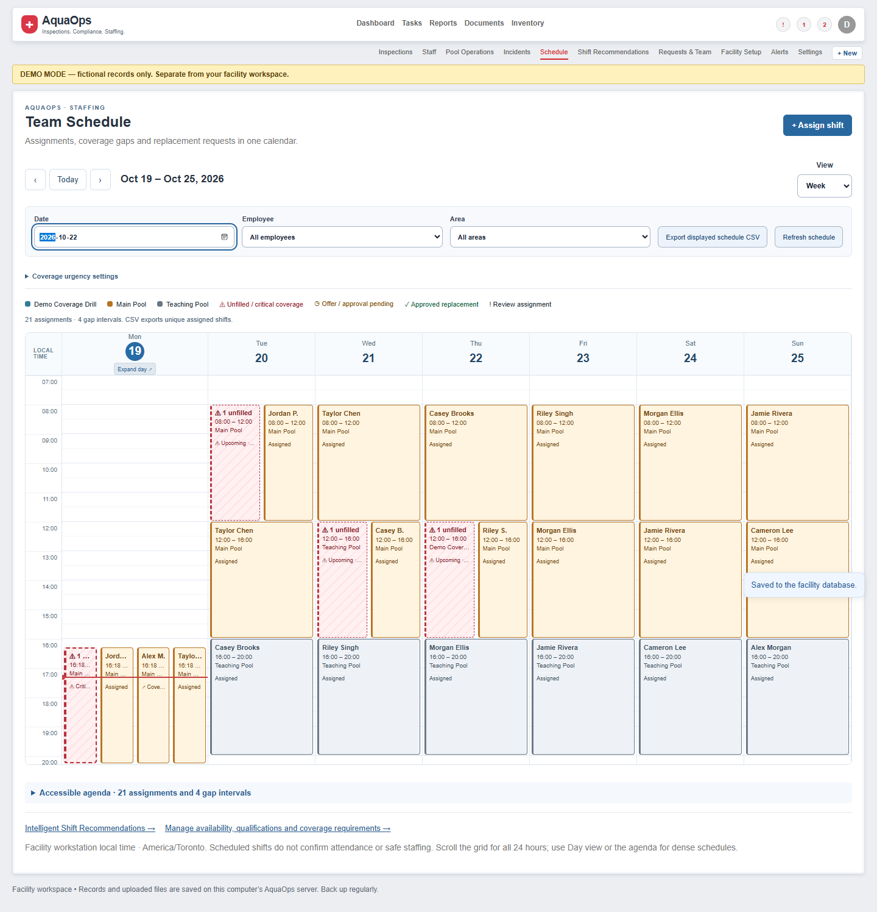
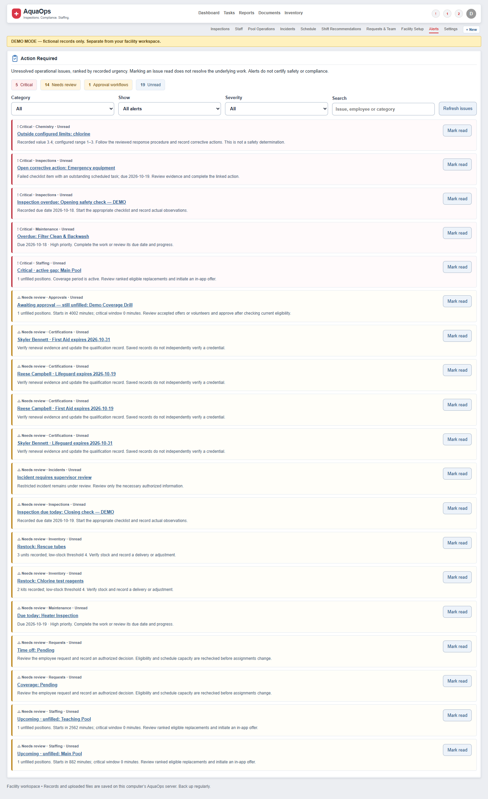
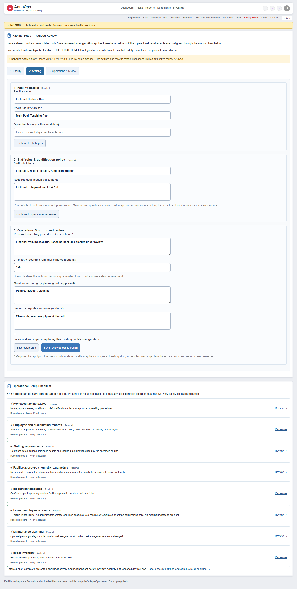
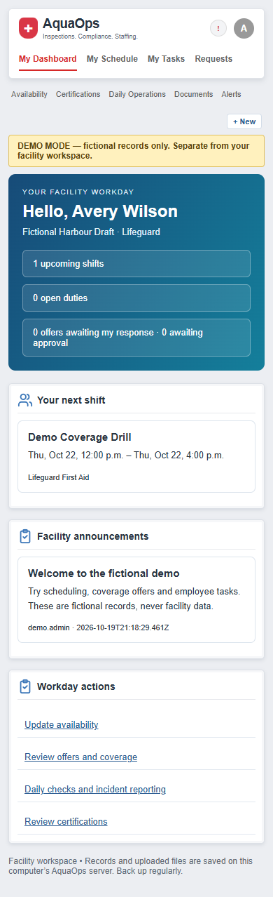
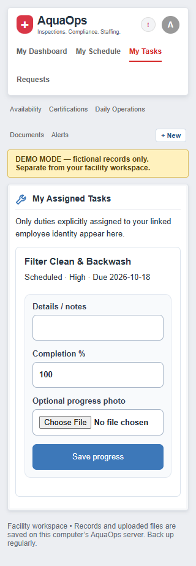

# AquaOps product polish and reliability report

19 October 2026. Local release only; no push, deployment or external notifications. This report covers the eight-phase product-polish objective. Public GitHub release is a separate blocked task: a shared-conversation link remains in historical commit `d0e8d83`; no history cleanup or public-release assurance is implied here.

## Completed changes

| Phase | Delivered and verified |
| --- | --- |
| 1. Weekly calendar | Red unfilled/critical gaps, orange offered/accepted-awaiting-approval, green approved replacement indicators; regular shifts retain area colours. Supervisor-configurable urgency, actual gap timing, current offer snapshot matching, spare-lane expansion, compact names, focus/hover previews, Expand Day and accessible agenda. Existing overnight/DST/time positioning preserved. |
| 2. Action Required | Current staffing, approvals, certification, inspection, corrective, maintenance, chemistry and stock issues; priorities, explanations, search/category/severity/read filtering and direct workflows. Related offers consolidate into gap issues; failed inspections and linked corrective tasks avoid duplicate issues. Read status is acknowledgement, not resolution. Employee alerts remain private. |
| 3. Guided onboarding | Three guided sections; required/optional checklist; incomplete shared draft save/resume; reviewed apply with existing-data confirmation. Staff, shifts, readings, thresholds, accounts and templates are preserved. Working links configure real operational records; administrators create linked local employee accounts. |
| 4. Employee refinement | Clear acceptance/approval and coverage responsibility messages; previous/next/Today week navigation; invalid-date recovery; eligible-first available shifts with exclusion reasons; private-read Retry; credential history distinctions; meaningful empty states; permission-aware Quick Actions; corrected 320px task controls. |
| 5. Product UX audit | All 15 administrator/manager routes at desktop/phone widths; all nine authorized employee routes at 390/320px. Manager and authorized employee Quick Actions open actual workflows. Existing broader CRUD, upload, inspection, chemistry, inventory, report, settings and account suites pass. Original dashboards retained. |
| 6. Reliability/security | In-flight manager revocation prevents the pending write. Snapshot verification uses one read transaction and validates accounts/private history/evidence; unexpected SQL logic is rejected. Restore rejects incomplete files and live sources with uncheckpointed WAL, preserves sources and requires a new destination. |
| 7. Demonstration | Separate presentation launcher/port/generations preserve ordinary demo and real storage. Ten-step fictional script, supported capability list, replay instructions and explicit boundaries. Actual manager→offer→employee accept→approval→calendar→operations→employee schedule rehearsal passed. |
| 8. Handoff | Full automated/browser/scale gates, screenshots, current guides/readiness/roadmap/README, local checkpoints and verified data-preservation checks. |

## Defects corrected

- Future uncovered periods were previously too uniformly urgent; urgency now uses configured minutes and actual active intervals.
- Narrow overlap columns wasted available lanes and truncated names without an adequate preview; spare-lane expansion and complete accessible previews now supplement compact labels.
- Pending approvals and their unfilled requirement could produce redundant notifications; related request IDs now live on the consolidated issue.
- Incomplete setup could not be safely resumed; drafts now preserve fields and section independently of live configuration.
- Failed employee reads could leave a stuck loading view; retry uses current-session/navigation guards.
- Employee task file controls overflowed the viewport at 320px; intrinsic grid sizing is constrained rather than hiding overflow.
- Setup fields inherited inline label/control placement; scoped stacked labels and full-width fields improve alignment without changing the homepage.
- Copying a live SQLite main file could omit committed WAL records. Restore now refuses that source and incomplete snapshots; completed verified snapshots are the documented recovery route.
- Browser regressions assumed a 09:00–17:00 period today remained upcoming after 17:00, and assumed one heading when the same shift appears in weekly and upcoming views. Fixtures/assertions now cover the intended future assignment without those clock-dependent assumptions.

## Verification

Baseline: **87 automated tests and six browser suites**. Final automated gate: **110 passed, zero failures** (`node --test tests/*.test.js`, local ignored log `test-data/polish-final-automated.log`). All seven Edge suites passed, with zero page errors:

1. `browser.cjs`: original dashboard geometry/style, CRUD, replacement, operational workflows, uploads, JSON merge, account/session behavior, mobile and conflicts.
2. `browser-access.cjs`: account roles/disable/reset, stale editor protection, manager restrictions and password/session handling.
3. `browser-portal.cjs`: private employee/manager workflows, actual offers/approval, availability, duties/evidence, authorized operations, onboarding, reports and responsive layouts.
4. `browser-chemistry.cjs`: supplemental definitions, alerts, authorized employee readings, retained history, trends/CSV/archive and phone layout.
5. `browser-recommendations.cjs`: actual ranking/exclusions, decline/re-offer/accept/approve, existing-shift replacement, unchanged assignments before approval and dashboard preservation.
6. `browser-calendar.cjs`: week geometry, overlaps, overnight/DST review, filters/CSV, keyboard details/editing, direct recommendations, mobile, errors/retry and employee restrictions.
7. `browser-polish.cjs`: persisted urgency/status progression, Action Required resolution, draft/resume/apply/account setup, employee error/empty states, every role route and authorized Quick Actions at tested widths.

`node tests/scale.cjs` passed: 2,001 synthetic records, ten core pages at 1280/768/390px, search/export/draft preservation, restart persistence, full recovery, preserved account login and revoked restored sessions. Node syntax, PowerShell parsing and Git whitespace checks passed. Tests use isolated synthetic databases; actual-account authentication was not reset or claimed tested.

New regression coverage lives in `coverage-status.test.js`, `attention.test.js`, `polish.test.js`, `recovery-hardening.test.js`, expanded `demo.test.js`, and `browser-polish.cjs`. Cases include stale offers, partial gap intervals, priority/dedup/resolution, role isolation, invalid/stale drafts, recovered drafts, revoked in-flight writes, invalid recovery request/account metadata, missing active administrators, unexpected SQL triggers, partial/WAL sources, independent presentation reset and filesystem aliases into protected facility storage.

## Screenshots

These are browser-generated synthetic fixtures with visible Demo Mode banners, visually reviewed locally. They contain no real facility/person records. Generated databases, logs and backups remain ignored.

### Calendar: red gaps, retained area colours and dense-day controls

### Action Required: explanations and consolidated approval workflow

### Guided setup: unapplied draft and required/optional checklist

### Private employee dashboard and corrected 320px task form

## Preservation and launch

Pre-change checkpoint `64b8522`; phase checkpoints `8a26d80`, `f99294b`, `0f19c0b`, `6f0bd3a`. Fresh verified snapshots before preview restart: actual `full-2026-10-19T21-14-50-238Z-bad54f27378ce999.sqlite`; ordinary demo `full-2026-10-19T21-14-50-255Z-99f6c367093a64f3.sqlite`. Both originals were reverified unchanged: actual revision 0 / zero operational records, ordinary demo revision 4 / 124 records. Existing accounts and stored configuration remain. The completed presentation generation and its verified snapshot were retained before generating a fresh replay scenario.

Use Node 24.14+ within 24.x (tested 24.19). No runtime npm packages or build step are required.

- `Start-AquaOps.cmd`: existing facility, http://127.0.0.1:8000.
- `Start-AquaOpsDemo.cmd`: retained fictional demo, http://127.0.0.1:8001.
- `Start-AquaOpsPresentation.cmd`: independent fictional presentation, http://127.0.0.1:8002.

Current client/server protocol 10. The launcher checks the requested data location and rejects stale/incompatible servers. See the demonstration script, README, administrator and employee guides. Stop only the process ID printed by the relevant launcher.

## Remaining limitations and production blockers

- One facility per database/server; no hosted multitenancy or network release. Isolation tests demonstrate independent databases and private roles, not a multi-tenant security certification.
- Linked employees have private scope; trusted legacy operator/viewer roles intentionally have broader shared operational access. Review account choice and permissions with the facility owner.
- Operating hours, role/qualification policy text and maintenance/inventory categories include planning notes. Actual dated requirements/credentials/chemistry/checklists are separate saved operational records; text notes do not enforce a comprehensive municipal policy. No external employee invitations.
- Offset-free local timestamps require manual review around repeated/nonexistent DST endpoints. No payroll/labor-law certification, partial-period optimization, unattended recurring rotation, or per-pool chemistry datasets.
- Thresholds/credentials/readings require authorized verification. In-app warnings and successful tests do not establish safe operation or regulatory compliance.
- No application-level storage encryption, MFA/network TLS deployment, malware scanning, immutable audit signatures, formal retention/purge process or scheduled protected off-device backup. Independent security/privacy/safety/accessibility reviews and an owner-run off-device recovery rehearsal remain necessary before sole-system or network reliance.
- Local instances share a host cookie name in the same browser profile; use separate profiles/private contexts for simultaneous roles/instances. Local port separation is not an isolation boundary against an untrusted process on the same machine.
- Snapshot validation is structural, not proof that an arbitrary untrusted backup is safe or authentic. Protect trusted completed snapshots; live main-file copying is unsupported. Nothing in this expedition publishes private records.
- GitHub portfolio/public release remains blocked by the historical conversation URL pending the owner's decision; history was preserved, not silently rewritten.

Recommended next work: resolve public-release privacy separately; conduct owner-supervised facility/permission and off-device recovery rehearsal; independent accessibility/security review; then implement only adopted facility requirements such as structured operating-hours enforcement or separate pool chemistry scope.

All eight local polish phases are covered above. The fresh presentation is the stopping point; no additional speculative features or deployment are planned.
