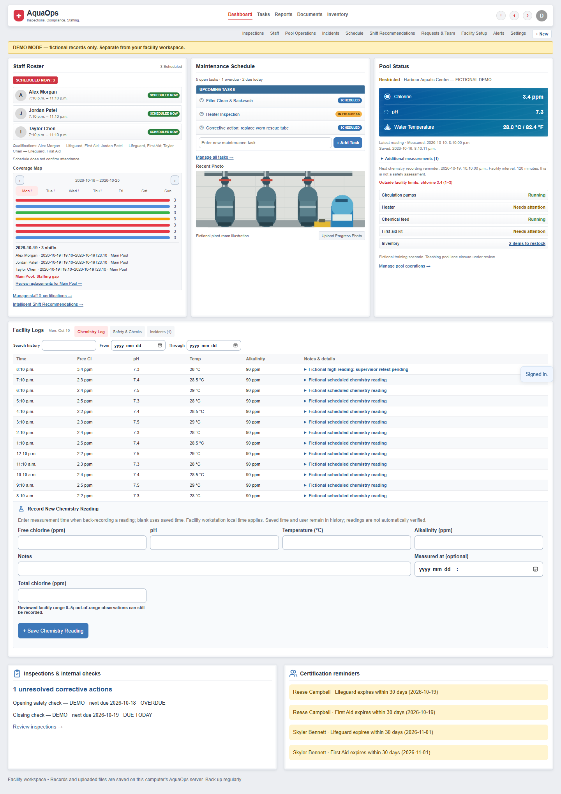
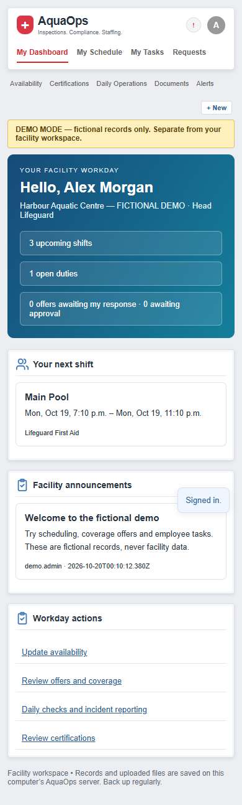
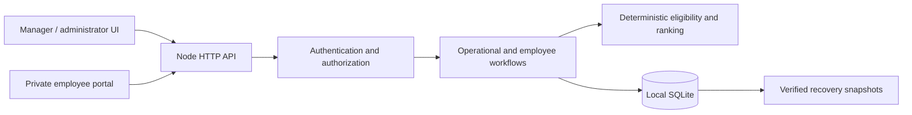

# AquaOps

**A full-stack aquatic facility operations platform with explainable staffing recommendations and private employee workflows.**

AquaOps brings schedules, qualifications, inspections, maintenance and pool records into one local application. Supervisors can identify uncovered periods and operational follow-ups, while employees get a clear view of their own responsibilities.

The project grew from a compact dashboard prototype into a persistent, role-based application. Its original three-column manager dashboard remains the visual foundation. The current release is a **locally runnable MVP**, with automated and browser verification; it is not approved for production or regulatory use.

## A look inside

These screenshots come from isolated fictional fixtures. No real employee or facility records are shown.

### Manager dashboard



### Employee portal



### Weekly scheduling


## Core features

| Area | Implemented workflows |
| --- | --- |
| Managers and administrators | Staff Roster / Maintenance Schedule / Pool Status dashboard, Facility Logs, account management, permissions, guided facility setup with unapplied drafts |
| Private employee portal | Own shifts/week, availability and recurring patterns, time-off/coverage requests, offers, duties/photos, credential submissions, approved documents and authorized daily operations |
| Staffing | Interactive day/week calendar, qualification-aware assignments, conflict detection, coverage requirements, urgency, explainable candidates and supervisor-approved replacements |
| Operations | Timestamped chemistry and supplemental measurements, configurable limits, history/charts, corrective actions, equipment and maintenance progress/evidence |
| Inspections | Custom opening/closing templates, retained results, failed-item corrective tasks and evidence attachments |
| Records | Inventory adjustments/low stock, controlled document uploads, confidential incident submission and restricted review |
| Reporting | Filtered operational summaries, staffing/replacement/certification forecasts, maintenance/inspection summaries and CSV |
| Reliability | SQLite transactions, stale-write protection, audit history and verified full snapshots restored into new directories |

Role-aware Quick Actions open working forms. **Action Required** consolidates operational issues with priority, explanations, read state and direct workflow links. Saved records resolve issues; marking an alert read does not resolve the work.

## Explainable shift recommendations

The recommendation engine is **deterministic; it does not use a generative AI model** or send employee records to an external API.

1. Detect a saved staffing gap or employee coverage request.
2. Check active employment, certifications through shift end, confirmed availability, approved leave, schedule overlap, configured rest/hour limits and area eligibility.
3. Rank only eligible employees using recorded workload and soft preferences. Candidate cards explain every check and the 0–100 fit score. A scoring reference is not a legal work-hour limit.
4. A manager sends an in-app offer; the employee accepts or declines.
5. A supervisor approves after fresh eligibility/capacity checks in a transaction. **Acceptance alone never assigns a shift.** The schedule, audit and alerts update from the saved decision.

[Detailed scoring and workflow guide](AQUAOPS_SHIFT_RECOMMENDATIONS.md)

## Technology and architecture

- **Frontend:** vanilla JavaScript, HTML and CSS; responsive manager and employee experiences; no build step.
- **Backend:** Node.js 24 built-in HTTP server and server-side authorization.
- **Storage:** built-in SQLite, WAL/full synchronous transactions, operational workspace plus account/session/file/audit and private workflow tables.
- **Authentication:** salted scrypt hashes, expiring HttpOnly/SameSite cookies, CSRF checks and account/session revocation.
- **Testing:** Node test runner and Playwright with Microsoft Edge.
- **Runtime dependencies:** none. No cloud account, AI API key or database service is required.



One facility is stored per database/server. Separate scoped APIs enforce employee privacy; frontend visibility is not the access boundary. Trusted legacy operator/viewer roles intentionally have broader shared access. [Technical documentation](AQUAOPS_TECHNICAL_GUIDE.md) explains role details, formats and recovery.

## Local setup

Requires **Node.js 24.14+ within 24.x** (tested on 24.19) and a current browser. SQLite uses Node's built-in API. No npm installation step is required for the app.

```powershell
git clone https://github.com/GurtajOthi/AquaOps.git
cd AquaOps
node server.js
```

Open **http://127.0.0.1:8000** and keep the terminal open. On a new installation, read the generated local setup token at `data/setup-token.txt`, then create your own administrator account. **There are no default real-facility credentials.** On Windows, `Start-AquaOps.cmd` finds a compatible Node runtime, starts a hidden preview and opens the browser.

Optional variables: `PORT` (default 8000), `AQUAOPS_DATA_DIR` (default `data/`) and launcher-only `AQUAOPS_NODE`. See [.env.example](.env.example); .env files are not loaded automatically. The server binds only to 127.0.0.1. Keep the same data directory to preserve records.

## Fictional demo and presentation

```powershell
node tools/demo.cjs start
# Independent replayable presentation on port 8002:
node tools/demo.cjs start --presentation
```

The ordinary demo uses **8001**; presentation uses **8002**. Windows alternatives: `Start-AquaOpsDemo.cmd` and `Start-AquaOpsPresentation.cmd`. The launcher prints **demo-only** credentials for generated fictional accounts. They are reproducible sample credentials, never live credentials. Confirm the **Demo Mode** banner.

Twelve fictional employees, qualifications, gaps, operations/history, sample documents and a labeled illustration are generated into separate retained directories. Real records are not copied or overwritten. Use separate browser profiles/private windows for simultaneous roles; ordinary tabs share a session. [Ten-step walkthrough and safe replay](AQUAOPS_DEMONSTRATION_SCRIPT.md).

## Testing and verification

Latest clean-publication verification: **114 automated tests, seven Edge browser suites, and a 2,001-record persistence/recovery smoke test passed**. This includes the 110 application tests plus four publication-audit regressions. Coverage includes roles, CRUD, scheduling conflicts, offer/accept/approve, private employee workflows, uploads, CSRF/revocation, stale updates, recovery and responsive layouts. [Detailed results and screenshots](AQUAOPS_PRODUCT_POLISH_REPORT.md).

```powershell
node --test tests/*.test.js
```

Browser tests need Playwright and an installed supported browser (development only). For example, install Playwright with `npm install --no-save --package-lock=false playwright`, then:

```powershell
$env:AQUAOPS_BROWSER_CHANNEL = 'msedge'
npm run test:browser
node tests/scale.cjs
```

If npm is unavailable, run the seven browser scripts listed in [package.json](package.json) directly with Node. Set `AQUAOPS_PLAYWRIGHT` to an existing Playwright package path if needed. Tests create ignored synthetic fixtures, not live facility records. The app itself requires no Playwright package.

## Development status and limitations

This is a locally usable MVP within the documented scope, not a hosted or production-certified system. Configured staffing and chemistry warnings do not prove compliance or pool safety. Authorized operators must verify credentials, thresholds, procedures and observations.

Remaining work includes independent security/privacy/accessibility and facility safety review, protected off-device recovery rehearsal, network TLS/MFA/hosting, malware scanning, formal retention/purge, encrypted storage and scheduled off-device backups. Operating-hour/category notes are not a comprehensive policy engine. Offset-free timestamps need manual DST ambiguity review. No external invitations/SMS/email or generative AI are configured. [Release readiness](AQUAOPS_RELEASE_READINESS.md) lists exact boundaries.

## Documentation

- [Administrator guide](AQUAOPS_ADMIN_GUIDE.md) · [Employee guide](AQUAOPS_EMPLOYEE_GUIDE.md)
- [Team calendar](AQUAOPS_TEAM_SCHEDULE.md) · [Staffing recommendations](AQUAOPS_SHIFT_RECOMMENDATIONS.md)
- [Technical setup, roles and recovery](AQUAOPS_TECHNICAL_GUIDE.md)
- [Fictional demonstration](AQUAOPS_DEMONSTRATION_SCRIPT.md)
- [Roadmap](AQUAOPS_MASTER_ROADMAP.md) · [Development progress](AQUAOPS_PROGRESS.md)
- [Pilot checklist](AQUAOPS_LOCAL_PILOT_CHECKLIST.md) · [Release readiness](AQUAOPS_RELEASE_READINESS.md)

Local databases, sessions/setup material, uploads, test fixtures and operational backups are excluded from publication. Never commit actual facility data or reuse demo credentials for real accounts.
